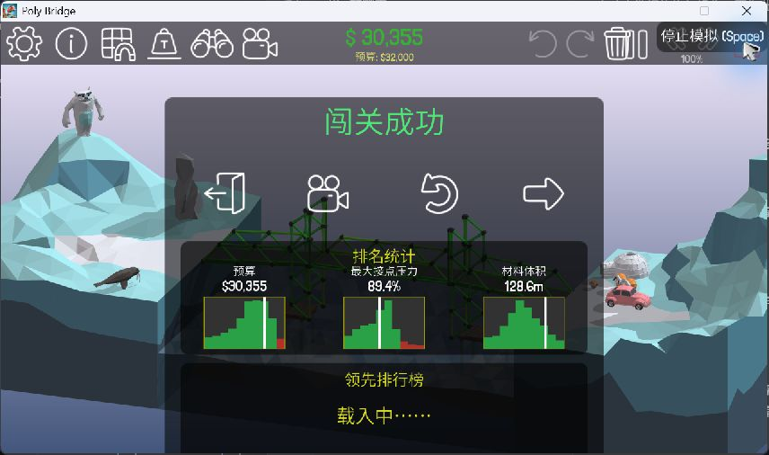

# Poly Bridge Automation Skill

面向 Codex 的原版 **Poly Bridge（Windows）造桥自动化 Skill**。将存档识别、桥梁设计、校验、备份注入、游戏模拟和失败迭代串成一个工作流程。

包含游戏内实测通过的 **1-1～1-5 和 3-13**。3-13 使用双级液压抬桥，实际造价 **$30,355 / $32,000**，最大接点压力 **89.4%**。



## 使用要求

- 原版 Poly Bridge；不适用于 Poly Bridge 2/3。
- Node.js 18 或更高版本。脚本只使用 Node.js 内置模块，无需安装 npm 依赖。
- Codex 环境中可用的原生 Windows 电脑控制工具。实际操作游戏前，代理必须读取并遵循该工具的电脑控制技能。

这是代理技能和命令行辅助脚本，不是游戏内 Mod，也不是独立物理引擎。没有电脑控制工具时，仍可生成设计和注入计划，但不能声称已完成游戏模拟。

## 安装与调用

将此仓库克隆到本机 Codex 技能目录下的 `polybridge-automation` 文件夹（通常是 `~/.codex/skills/polybridge-automation`），使 `SKILL.md` 位于技能文件夹根目录。如果已存在同名 Skill，先备份旧版本。

调用示例：

```text
使用 $polybridge-automation 直接通关 3-13，不需要通关前置关卡。
先备份该关存档，再按游戏模拟结果迭代。
```

Skill 入口：[SKILL.md](SKILL.md)。安装不会授予操作存档或电脑的权限，代理仍需遵循用户在当前任务中的授权范围。

## 命令行

在仓库根目录运行：

```text
node scripts/polybridge.cjs help
node scripts/test.cjs
node scripts/polybridge.cjs inspect "path/to/slot"
node scripts/polybridge.cjs preset --level 3-13 --baseline "path/to/slot" --out "work/candidate.save"
node scripts/build-3-13.cjs "path/to/slot" "work/generated-3-13.save"
```

`preset` 与 3-13 生成器都会核对基准锚点。普通桁架生成器支持平桥、斜坡和多跨桥；液压校验支持长度倍率与关卡材料数量约束。生成设计只会写候选文件，不会自动修改游戏。

向游戏写入设计时，先通过游戏创建手动槽，确认实际使用的 `savefiles` 根目录，然后创建可审阅的计划：

```text
node scripts/polybridge.cjs plan --root "path/to/savefiles" --level 2DeckerBoat --slot 0 --candidate "work/candidate.save" --out "work/plan.json" --budget 32000 --allowed road,wood,hydraulic --limits "references/3-13-limits.json"
node scripts/polybridge.cjs apply --plan "work/plan.json" --backup-root "work/backups" --commit
```

执行 `apply` 前确认用户已授权对应修改。它会备份整关目录，核对目标和候选文件的哈希，再替换已有数字槽。进入游戏载入该槽，并实际运行模拟；静态校验不能证明承重、净空或通关。

回滚使用注入返回的 `manifest.json`：

```text
node scripts/polybridge.cjs restore --manifest "work/backups/snapshot/manifest.json" --commit
```

如果槽位后来被游戏或其他操作改写，回滚会拒绝覆盖，以免丢失新的设计。

## 已验证的设计

| 关卡 | 内部名称 | 游戏造价 | 预算 | 最大接点压力 |
|---|---|---:|---:|---:|
| 1-1 | Easy_001 | $5,508 | $7,000 | 59.2% |
| 1-2 | Easy_002 | $6,950 | $8,000 | 47.5% |
| 1-3 | Easy_003 | $9,104 | $10,000 | 43.6% |
| 1-4 | Easy_004 | $7,369 | $9,000 | 65.1% |
| 1-5 | Easy_007 | $15,439 | $18,000 | 69.9% |
| 3-13 | 2DeckerBoat | $30,355 | $32,000 | 89.4% |

这些是历史游戏实测结果。更换游戏版本、关卡布局或设计后应重新模拟。仓库只包含桥梁设计及游戏结果截图，不包含游戏程序、游戏程序集、账户资料或关卡进度文件。

## 进一步说明

- [存档编码、坐标、材料和液压参数](references/save-format.md)
- [3-13 抬桥结构与事件顺序](references/3-13-lift.md)
- [游戏载入、观察和模拟闭环](references/game-loop.md)
- [预置目录及证据索引](references/verified-levels.json)

脚本会拒绝锚点不匹配、超长杆件、超预算、材料数量超限、无效液压倍率、无锚定的活动组件及已经过期的注入计划。它不会直接修改 `progress.bytes`，也不会跳过游戏内验证。
